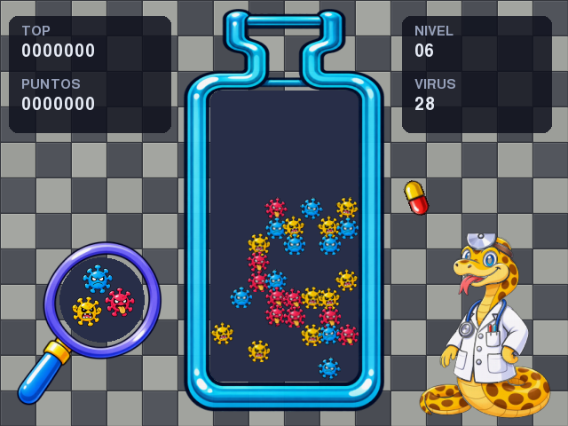

# Dr. Python (versión Pygame)

Puzzle de pastillas y virus. Se dibuja siempre en 640x480 y se escala a la pantalla real.
Corre en Linux x86 y en consolas Anbernic (ARM).



## Cómo jugar

```bash
python -m venv .venv
.venv/bin/pip install -r requirements.txt
.venv/bin/python main.py            # --fullscreen o --window para forzar
```

Se usa `pygame-ce`: el `pygame` 2.6.1 no carga fuentes con Python 3.14.

## Reglas

- Tres virus: rojo, amarillo y azul. Nunca arrancan 3 en línea.
- **4 o más** del mismo color en línea (horizontal o vertical) se eliminan.
- Las mitades que quedan sueltas caen hasta chocar con algo; las caídas pueden encadenar combos.
- Se pasa de nivel al eliminar todos los virus; se pierde si la pastilla nueva no tiene lugar.
- El récord se guarda en disco.

## Controles

Cada comando tiene **una sola lista** que mezcla teclado, mando y mouse. Se cambian desde
**CONTROLES** (en el título o en la pausa): elegís el comando, **Aceptar** agrega la próxima
entrada que toques y **Rotar antihorario** quita la última.

| Comando | Teclado | Mando | Mouse |
|---|---|---|---|
| Izquierda / derecha | ← → · A D | cruceta, palanca izq. | ruedita (arriba = izq.) |
| Abajo / bajar rápido | ↓ · S | cruceta, palanca | botón del medio |
| Arriba (menús) | ↑ · W | cruceta, palanca | |
| Rotar horario | ↑ · X · K | botón 0 | clic izquierdo |
| Rotar antihorario | Z · J | botón 1 | clic derecho |
| Pausa | P | botón 7 | |
| Aceptar | Enter · Espacio | botón 0, 7 | clic izquierdo |
| Volver / salir | Esc · Retroceso | botón 6 | |

- Funcionan varios mandos a la vez (los controles de la Anbernic más un mando Bluetooth) y se
  pueden conectar o desconectar con el juego abierto.
- Si dos dispositivos sostienen el mismo comando y se suelta uno, el comando sigue activo.
- Con izquierda y derecha apretadas a la vez, gana la última que se apretó.
- Las asignaciones de mando sirven para cualquier mando; las que se agregan desde la pantalla
  de controles quedan para ese modelo (se marcan con `*`).

## Anbernic / PortMaster

- Sin escritorio (consola/KMS) arranca en pantalla completa con barras negras: 720x720 → 720x540,
  1280x720 → 960x720. Se puede fijar en `settings.json` con `"fullscreen": true/false/"auto"`.
- Configuración y récord van a `$XDG_CONFIG_HOME/dr-python/` (o `~/.config/dr-python/`).
  Para PortMaster conviene apuntarla a una carpeta escribible con `DRPYTHON_CONFIG_DIR=conf/`.
- Si se usa gptokeyb, desactivar su autorrepetición: la repetición de izquierda/derecha ya la hace el juego.
- No hace falta mouse: todo se puede hacer con teclado o mando.

## Estructura

| Archivo | Qué hace |
|---|---|
| `main.py` | Ventana o pantalla completa, escalado y loop principal |
| `config.py` | Constantes, rutas y guardado de archivos de usuario |
| `board.py` | Tablero, pastilla, colisiones, matches y caídas (sin pygame) |
| `game.py` | Estados del juego y menús; recibe comandos, no teclas |
| `controls.py` | Entrada unificada, autorrepetición, mandos en caliente y reasignación |
| `renderer.py` | Todo lo que se dibuja y la posición de cada cosa |
| `sprites.py` | Carga los sprites ya preparados |
| `tools/build_assets.py` | Recorta y achica las hojas de `assets/src/` a `assets/` |
| `tests/test_logic.py` | Pruebas sin ventana: `python tests/test_logic.py` |
