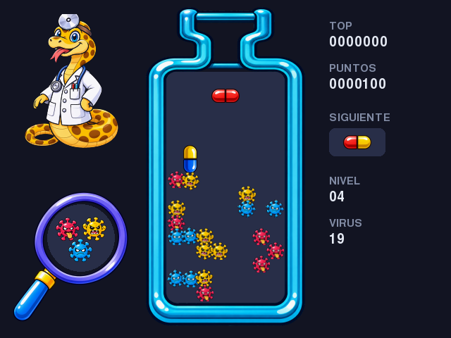

# Dr. Python (versión Pygame)

Puzzle de pastillas y virus a 640x480 hecho con Pygame.



## Cómo jugar

```bash
cd pygame
python -m venv .venv
.venv/bin/pip install -r requirements.txt
.venv/bin/python main.py
```

Se usa `pygame-ce`: el `pygame` 2.6.1 no carga fuentes con Python 3.14.

## Reglas

- Tres virus: rojo, amarillo y azul.
- 3 o más del mismo color en línea (horizontal o vertical) se eliminan (`MATCH_LEN` en `main.py`).
- Las mitades de pastilla que quedan sueltas caen hasta chocar con algo; las caídas pueden encadenar combos.
- Se pasa de nivel al eliminar todos los virus; se pierde si la pastilla nueva no tiene lugar.

## Controles

| Tecla | Acción |
|---|---|
| ← → | Mover |
| ↓ | Bajar rápido |
| ↑ / X | Rotar horario |
| Z | Rotar antihorario |
| P | Pausa |
| Enter | Empezar / seguir |
| Esc | Salir |

## Archivos

- `main.py`: lógica del juego y dibujo.
- `sprites.py`: recorta las hojas de sprites de `assets/` y arma el frasco a la medida del tablero.
- `assets/`: virus, cápsulas, frasco, lupa y el doctor (8 cuadros).
